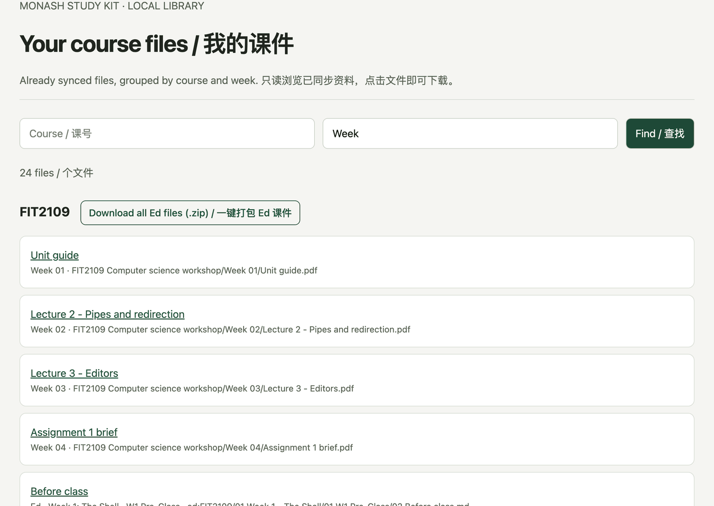

The `monash` command does not use any AI, so it works when you are out of AI usage or just want a quick look. Run `monash sync` first, then:

| I want to know | Command |
| --- | --- |
| What to do this week | `monash todo` |
| Deadlines | `monash due` or `monash due FIT2102` |
| Which file or page covers a topic | `monash grep "git rebase"` |
| New Ed posts and replies | `monash ed new` |
| Replies to my own posts | `monash ed following` |
| Read a full post | `monash ed show FIT2102#42` |
| Grades | `monash moodle grades FIT2102` |
| Assignments I may have missed | `monash moodle assignments --missing` |
| Unread school mail (if [connected](/study-kit/mail-attendance/)) | `monash gmail todo` |
| Classes I haven't checked in to (if connected) | `monash attendance overview` |
| This week's deadlines, lessons and attendance on one page, or as a calendar file | `monash semester --days 7`, add `--ics` to export |
| A whole unit's Ed materials as one zip | `monash ed export FIT2109` |
| Attendance codes (if connected) | `monash attendance codes` |

You get the raw information without a summary. You can paste the output into any AI if you want one.

Background sync and session refresh run while your AI app is open, because that is when the MCP server runs. They keep going even if your usage runs out. If the app is closed, run `monash sync` before you query, and `monash login` if Moodle has expired.

Every command is listed on [Command reference](/study-kit/commands/).

## Browse your course files

```bash
monash library --open
```

This opens a page in your browser that lists every Moodle and Ed lesson file already synced, with a unit's Moodle and Ed files in the same group. Filter by unit, week or file name and click a file to download it. It is handy when you just want the week 7 slides without asking an AI. Units with Ed materials also get a **Download all Ed files (.zip)** button next to their name, giving the same zip as `monash ed export` below (1.7.0 and later).



- It only shows what `monash sync` has already downloaded. It does not sync by itself.
- It listens on `127.0.0.1` only, so other devices on your Wi-Fi cannot open it. The default port is 8766; use `--port` to pick another one.
- It has no login, so do not forward it to the internet. Stop it with Ctrl-C.

Needs Study Kit 1.4.0 or later.

## Download a unit's Ed materials as one zip

```bash
monash ed export FIT2109
```

This packs the Ed Lessons you have synced for that unit into one zip in your Downloads folder, sorted by week like the download-all button in [Ed Web](/ed-web/):

```
FIT2109 Ed Lessons/
  README.md                         progress per lesson, the Ed page, any file that failed to download
  04 Week 3 - Editor-Modern IDE/
    12 W3 Workshop/
      01 Workshop 3 Slides.pdf
      02 starter.zip                a file attached inside an Ed page
      Links.md                      the lesson's reading pages and its Ed page
```

- `--module "Week 3"` packs one week, `--to <folder>` saves it elsewhere, and `--open` shows the zip in Finder or Explorer.
- It only uses files already synced to your computer and never goes online. Run `monash sync` first.
- You can also ask your AI app: "zip up my FIT2109 Ed materials".
- To browse without zipping, `monash open ed` opens the Ed materials folder, sorted by unit, week and lesson in Ed's order.

Needs Study Kit 1.7.0 or later. After upgrading from an older version, the first sync moves the Ed files you already have into the new folders instead of downloading them again.

## What search covers

`monash grep` and the AI's course-file search look at:

- Moodle course files: PDF, Word, PowerPoint, text and code, including text files inside `.zip` archives
- PDFs in Ed Lessons, files attached inside Ed pages (1.7.0 and later, up to 200 MB each), and pages written directly in Ed
- **Course-notes websites** that a unit links to, such as tgdwyer.github.io for FIT2102. Only pages the unit links directly are fetched, never a whole site, and each page at most once a week. Turn it off with `monash config web_notes false`
- Lecture-recording transcripts, if you set up [recordings](/study-kit/recordings/)

## Export a whole unit

```bash
monash export FIT2109 --sync --format both --to "./exports"
```

Without `--sync`, this reads only the local cache; `--refresh-google` implies sync. PDF is the initial default; `both` keeps Markdown too, with Markdown fallback if no supported browser exists. See [whole-course export](/study-kit/materials/) for contents, isolated profiles, the missing-item index and options.
