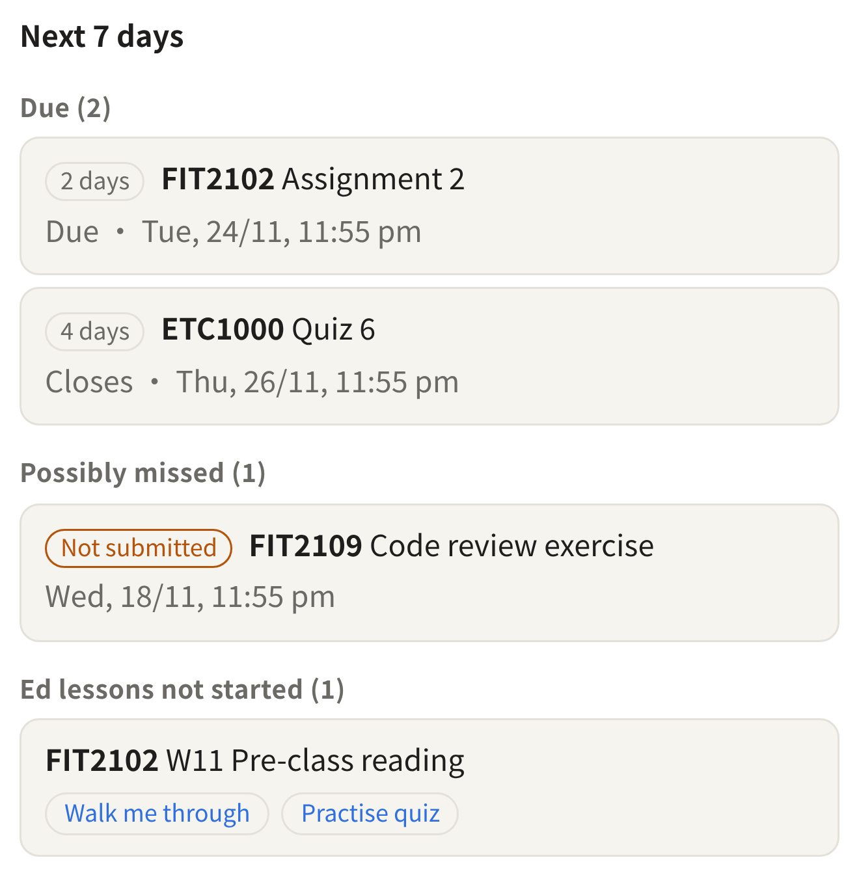
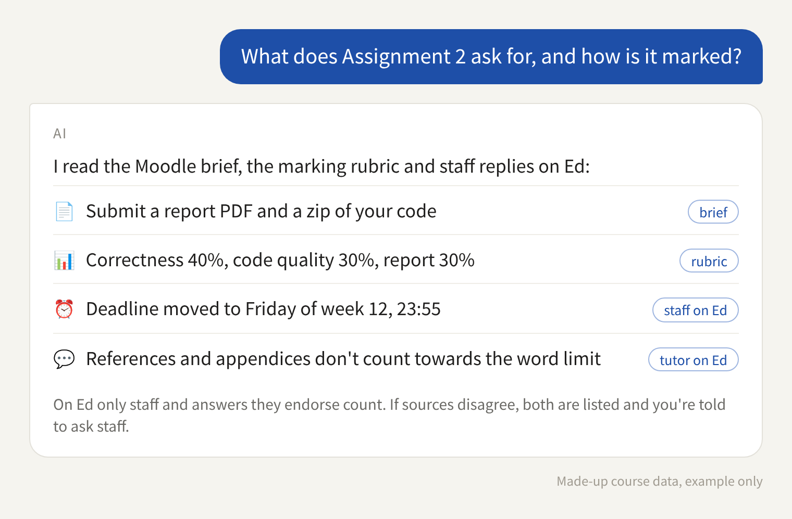

import { LinkCard, CardGrid, Aside } from '@astrojs/starlight/components';

Study Kit lets the AI app on your computer (Claude, ChatGPT, Codex, Cursor and others) read your own Monash **Moodle** and **Ed**, so you can ask it instead of going through each site yourself.

## Install it the easy way

If your AI app can run commands (Claude Code, Codex or Codex mode in the ChatGPT app, Cursor's agent, Gemini CLI), paste this and it installs everything for you:

```text wrap
Read https://docs.secureview.tech/agents/study-kit.md and set up Monash Study Kit on my computer.
```

You only do two things yourself: paste your Ed token and pass Monash MFA in a login window. The AI tells you when. [More on this](/ai-setup/), or [install it by hand](/study-kit/install/) with one command.

## What you can ask

- "What work and tasks do I need to finish this week?" Deadlines, work you may have missed, unfinished Ed lessons, new announcements.
- "What have staff added on Ed? What have other students asked?"
- "Which week covered regression, and which page of the slides?"
- "What does Assignment 2 ask for, and how is it marked?" "What's my grade in FIT2109 so far?"
- "Read what I submitted for Assignment 1 and go through the marker's comments with me."
- "What changed in my units this week?" New files, edited assignment instructions, moved deadlines and staff replies.
- "Quiz me on FIT2109 week 3."
- "Zip up all my FIT2109 materials." Moodle files, Ed Lessons and linked Google files in one package, as PDF or Markdown. See [whole-course export](/study-kit/materials/).
- Optional: "Anything in my school email I need to deal with?" and "Which classes haven't I checked in to?" See [School mail and attendance](/study-kit/mail-attendance/).

Answers come from your real Moodle and Ed, with a source like "Workshop 5 Slides, page 25". The AI opens the right file and reads only the pages it needs, so you don't download PDFs and upload them again.

In apps that support panels, asking about this week also shows a to-do panel you can click:



Ask about an assignment and every point comes with its source:



More questions and example answers are in [What to ask your AI](/study-kit/ask-claude/).

## What it never does

Moodle and Ed are **read-only**. It never submits assignments, attempts quizzes or posts on Ed. The optional mail and attendance parts can draft mail or check you in, and only after you see the full preview and confirm. Your files, logins and database stay on your computer. When you ask your AI app something, the results it looks up go to that AI app, like anything else you type there.

## You need

- A computer with Windows, macOS or Linux. On an iPhone, iPad or Android phone you can use it through the ChatGPT or Claude app once it runs on a computer or server in [remote mode](/study-kit/remote/).
- An AI app:
  - **Claude Desktop** ([download](https://claude.ai/download)) and **Claude Code** are the most tested, and `monash setup` connects them for you
  - **ChatGPT** chat on the web, desktop and phone works through [remote mode](/study-kit/remote/). Codex in the ChatGPT desktop app takes one command. See [Use it with ChatGPT](/study-kit/chatgpt/)
  - Codex, Cursor, VS Code, Windsurf and Gemini CLI also take one command, see [other AI apps](/study-kit/other-clients/)
  - Claude on the web or phone also needs [remote mode](/study-kit/remote/)
  - You don't need an AI app at all to export course files or use the `monash` command
- **Chrome, Edge or Brave** for the Moodle login window. The Edge that comes with Windows is fine.
- A Monash account.

<Aside>
Times follow Malaysia (UTC+8) by default. On an Australian campus run `monash config timezone Australia/Melbourne`, which also handles daylight saving.
</Aside>

## Next

<CardGrid>
  <LinkCard title="Install" description="One command on macOS or Windows, or let your AI do it." href="/study-kit/install/" />
  <LinkCard title="First-time setup" description="Ed token, Moodle login, units, your AI app. About five minutes." href="/study-kit/setup/" />
  <LinkCard title="Use it with ChatGPT" description="Chat on web, desktop and phone, or Codex in the desktop app." href="/study-kit/chatgpt/" />
  <LinkCard title="What to ask your AI" description="Example questions for each kind of task." href="/study-kit/ask-claude/" />
  <LinkCard title="Use it without AI" description="The same answers in your terminal." href="/study-kit/cli/" />
  <LinkCard title="School mail and attendance" description="Optional. Connect them by asking your AI app." href="/study-kit/mail-attendance/" />
</CardGrid>

Have a look at [privacy and security](/study-kit/privacy/) before connecting mail or attendance.

Source code: [Waldo0926/monash-study-kit](https://github.com/Waldo0926/monash-study-kit) (MIT).
