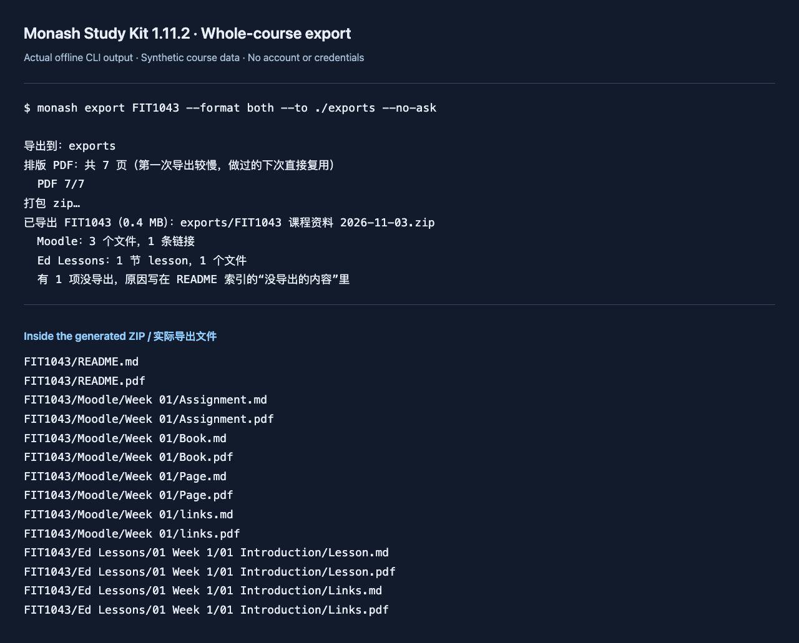

`monash export` puts everything a unit has on Moodle and Ed Lessons into one package on your computer. You don't need an AI app for this. Assignment instructions are included. Your own submissions, grades, feedback, Ed discussions, mail, messages and attendance are not.

The easiest way is to ask your AI: "Zip up all my FIT2109 materials." It runs the same command for you.



The demo above has one missing attachment and one Google link the account can't open, on purpose. Real units often have a few of these too, so have a look at the index in the package.

## First export

After [installing](/study-kit/install/) and [setting up](/study-kit/setup/):

```bash
monash courses
monash export FIT2109 --sync --format both --to "./exports"
```

Make sure the unit is ticked in `monash courses`, and use your own unit code instead of FIT2109.

- `--sync` fetches the latest Moodle content and Ed Lessons for that unit first. It doesn't fetch Ed forum posts. Without it, export uses what is already on your computer.
- `--to` is the folder to save into, not a zip file name. If you leave it out, a folder picker opens, starting at the folder you chose last time or your Downloads folder (a moved Windows Downloads folder works too).
- `--no-ask` skips the picker. `monash config export_dir "./exports"` remembers a folder.
- `--dir` saves a folder instead of a zip, and `--open` shows the result in Finder or Explorer.
- Put quotes around paths with spaces, on macOS and Windows.

## What is in the package

| From | What you get |
| --- | --- |
| Moodle files and folders | The original files and subfolders |
| Moodle Pages, Books and assignments | The text, the rubric or marking guide if you can see it, and attachments |
| Ed Lessons | Modules and lessons in Ed's order, slides, reading pages, files attached in Ed, and quiz questions (no answers) |
| Images | Moodle and Ed images saved in `assets/` and linked locally |
| Google files linked from the unit | Docs and Slides as PDF (Docs can be DOCX instead), Sheets as XLSX, other Drive files as they are |
| Index | What is inside, when it was synced, and what couldn't be downloaded and why |

Inside the unit folder you get `Moodle/`, `Ed Lessons/` and the index. PDFs, notebooks, zips and other course files stay in their own format. Outside links that can't be downloaded stay as links, since it doesn't copy whole websites. Meeting passwords are taken out of links.

## Google files

Google files need one extra install and a separate Google sign-in:

```bash
uv tool install --reinstall --refresh "monash-study-kit[gmail]"
monash google login
monash google status
monash export FIT2109 --refresh-google --format both --to "./exports"
```

The extra is called `gmail`, but Drive gets its own sign-in and doesn't touch your mail. If you installed other extras before, keep them in that install command.

- `--refresh-google` exports the Google files again, and also syncs. `monash sync --refresh-google` does the same without making a package.
- `monash config google_docs_format docx` saves Google Docs as DOCX. Slides stay PDF.
- It asks Google for **`drive.readonly`**. That permission can read every file your account can open, but Study Kit only fetches the files linked from your units, and it can't change anything in Drive. Mail is a separate sign-in (`monash gmail login`), see [privacy](/study-kit/privacy/).

A Google file can fail if it's too big, the Drive API is turned off, an admin blocks it, or it isn't shared with you. Study Kit then tries the Google session in its own login browser, but it can't get past file permissions. Google Forms are skipped. `monash google logout` revokes access first and keeps the local token if that fails, so you can try again.

## PDF or Markdown

```bash
monash export FIT2109 --format pdf --to "./exports"
monash export FIT2109 --format md --to "./exports"
monash export FIT2109 --format both --to "./exports"
monash config export_format both
```

PDF is the default. `both` gives you Markdown you can edit as well as the PDFs. PDFs are made with Chrome, Edge or Brave in a temporary window that can't load anything from the internet. If none of those browsers is installed, you get Markdown and the index says why. Add `--json` for a machine-readable summary.

Made PDFs are kept in `data/pdf-cache/` so the next export is faster. The oldest ones are removed when it goes over 500 MB. Moodle folders are usually checked at most once a week.

## A second account just for materials

Handy if you want materials from another Monash account, for example during exchange:

```bash
monash --profile exchange setup
monash --profile exchange google login
monash --profile exchange export FIT2109 --sync --format both --to "./exports"
monash profile list
monash profile remove exchange
```

Each profile keeps its own logins, files and database. A profile only does course materials: Moodle, linked Google files and Ed Lessons. It doesn't do mail, attendance, Ed discussions, your calendar, remote mode, `monash connect` or `monash move`, and setup doesn't connect it to an AI app. Your main account is not affected.

`monash profile remove NAME` (run from your main account) signs out of Google first. If that fails, nothing is deleted. Otherwise it clears the logins and keeps the downloaded files. Add `--all` to delete those too. Delete the Ed token yourself on Ed's token page. Read [privacy](/study-kit/privacy/) before you share an export with anyone.

## Something is missing

- Check the unit is ticked in `monash courses` and has synced. The matching Ed unit is picked up by itself.
- If the Moodle login window was closed too early, run `monash login` and try again. On macOS Chrome may still be running with no window open.
- For Google problems, run `monash google status`, sign in with the right account and export again with `--refresh-google`. Files not shared with you still won't come through.
- The index lists missing files, images it couldn't save and why Google files failed.
- No PDFs? Install Chrome, Edge or Brave, or use `--format md`.
- Automatic syncing only happens while your AI app is open. If you only use the terminal, add `--sync`.
