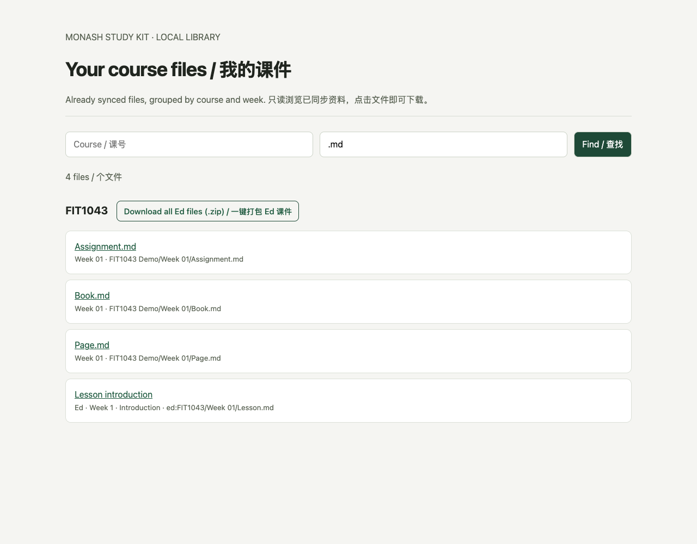

`monash` 命令不用任何 AI，AI 额度用完或者只想快速看一眼时都能用。先运行 `monash sync`，然后：

| 想知道 | 命令 |
| --- | --- |
| 这周要做什么 | `monash todo` |
| 截止日期 | `monash due` 或 `monash due FIT2102` |
| 某个知识点在哪份课件哪一页 | `monash grep "git rebase"` |
| Ed 上的新帖和新回复 | `monash ed new` |
| 我的帖子有没有人回 | `monash ed following` |
| 读某个帖子全文 | `monash ed show FIT2102#42` |
| 成绩 | `monash moodle grades FIT2102` |
| 可能漏交的作业 | `monash moodle assignments --missing` |
| 没读的学校邮件（[接上](/zh-cn/study-kit/mail-attendance/)以后） | `monash gmail todo` |
| 哪节课还没签到（接上以后） | `monash attendance overview` |
| 这周的截止、lesson 和考勤放在一页看，或导出成日历文件 | `monash semester --days 7`，加 `--ics` 导出 |
| 整门课的 Ed 课件打包成一个 zip | `monash ed export FIT2109` |
| 签到码（接上以后） | `monash attendance codes` |

区别是没人帮你总结，只列出原始信息。想要总结的话，可以把输出贴给任何 AI。

后台同步和续期是跟着 AI 软件跑的，因为软件开着时 MCP 服务器才在运行。就算额度用完也照常进行；软件关掉的话，查之前先 `monash sync`，Moodle 过期了先 `monash login`。

全部命令见[命令速查](/zh-cn/study-kit/commands/)。

## 在浏览器里翻课件

```bash
monash library --open
```

会在浏览器里打开一个页面，列出已经同步下来的 Moodle 课件和 Ed lesson 文件。同一门课的 Moodle 和 Ed 文件放在同一组里。可以按课程、周次或文件名筛选，点文件就能下载。只想拿第 7 周的 slides、不想问 AI 的时候很方便。有 Ed 课件的课，标题旁边还有一个**一键打包 Ed 课件**按钮，下载的是和下面 `monash ed export` 一样的 zip（1.7.0 起）。



- 只显示 `monash sync` 已经下载好的文件，它自己不会去同步。
- 只监听 `127.0.0.1`，同一个 Wi-Fi 下的其他设备打不开。默认端口是 8766，想换的话加 `--port`。
- 页面没有登录，不要把它转发到公网。按 Ctrl-C 关掉。

要 Study Kit 1.4.0 以上。

## 把整门课的 Ed 课件打包

```bash
monash ed export FIT2109
```

把这门课已经同步下来的 Ed Lessons 打成一个 zip，存到“下载”文件夹。和 [Ed Web](/zh-cn/ed-web/) 的“一键下载资料”一样按周分好：

```
FIT2109 Ed Lessons/
  README.md                         每节的进度、Ed 原页面链接，没下载到的文件
  04 Week 3 - Editor-Modern IDE/
    12 W3 Workshop/
      01 Workshop 3 Slides.pdf
      02 starter.zip                Ed 正文里附的文件
      Links.md                      这节的阅读网页和 Ed 原页面
```

- `--module "Week 3"` 只打包一周，`--to 文件夹` 换保存位置，`--open` 打包完在访达或资源管理器里显示。
- 只用本机已经同步的文件，不联网。先 `monash sync`。
- 在 AI 里说“把 FIT2109 的 Ed 课件打包给我”也行。
- 不打包也能直接翻：`monash open ed` 打开 Ed 课件文件夹，按 课号/周/lesson 分好，顺序和 Ed 页面一样。

要 Study Kit 1.7.0 以上。从旧版本升级后，第一次同步会把已经下载的 Ed 课件挪进新的文件夹，不会重新下载。

## 搜得到哪些内容

`monash grep` 和 AI 的课件搜索覆盖：

- Moodle 课件：PDF、Word、PowerPoint、文本和代码，包括 `.zip` 压缩包里的文本文件
- Ed Lessons 里的 PDF、Ed 正文里附的文件（1.7.0 起，单个最多 200 MB），以及直接写在 Ed 里的正文页
- 课程链接到的**课程笔记网页**，比如 FIT2102 的 tgdwyer.github.io。只抓课程直接链接的页面，不会整站爬，每页最多一周抓一次。不想要的话：`monash config web_notes false`
- 录播字幕稿，前提是装了[录播字幕](/zh-cn/study-kit/recordings/)

## 导出整门课

```bash
monash export FIT2109 --sync --format both --to "./exports"
```

不加 `--sync` 只读本地缓存；`--refresh-google` 隐含同步。PDF 为初始默认，`both` 同时保留 Markdown，缺浏览器时回退 Markdown。完整内容、账号隔离、遗漏索引和参数见[整课导出指南](/zh-cn/study-kit/materials/)。
