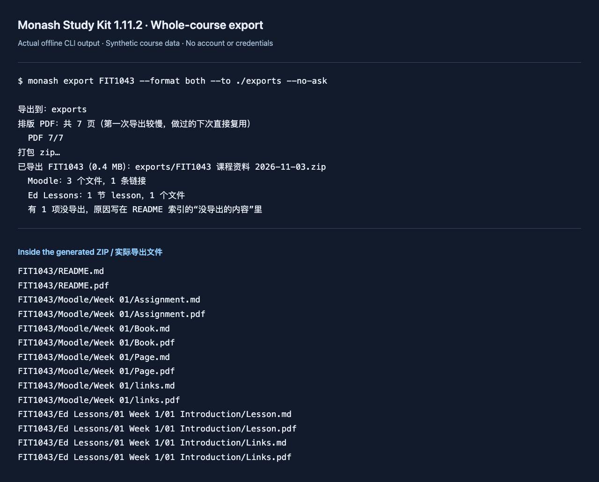

import { LinkCard, CardGrid, Aside } from '@astrojs/starlight/components';

Study Kit 让你电脑上的 AI（Claude、ChatGPT、Codex、Cursor 等）能读你自己的 Monash **Moodle** 和 **Ed**，不用再开一堆标签页翻，直接问就行

## 最省事的装法

如果你的 AI 能跑命令（Claude Code、Codex 或 ChatGPT App 里的 Codex 模式、Cursor 的 agent、Gemini CLI），把下面这句发给它，剩下的它来装：

```text wrap
阅读 https://docs.secureview.tech/agents/study-kit.md ，帮我在电脑上装好 Monash Study Kit。
```

你自己只要做两件事：粘贴 Ed 令牌，在弹出的窗口里过 Monash 的 MFA，到时候 AI 会提醒你，[详细说明](/zh-cn/ai-setup/)，也可以[自己用一条命令装](/zh-cn/study-kit/install/)

## 能问什么

- “这周我有什么要交的？” 截止日期、可能漏交的作业、Ed 上没做完的 lesson、新公告
- “Ed 上有什么新消息？我上次问的问题有人回了吗？”
- “FIT2102 哪一周讲了 monad？在哪份讲义第几页？”
- “A2 的 spec 要求什么？”“我 FIT2109 现在成绩多少？”
- “把我 A1 交的东西读一遍，对照老师的评语帮我看看哪里扣分”
- “这周我的课有什么变化？” 新上传的文件、改过的作业说明、改了的截止时间、老师的新回复
- “用 FIT2109 第 3 周的测验题考考我”
- “把 FIT2109 的资料全部打包给我” Moodle 文件、Ed Lessons 和链接的 Google 文件放进一个包，PDF 或 Markdown 都行，见[整课导出](/zh-cn/study-kit/materials/)
- 可选：“我学校邮箱里有什么要处理的？”“哪节课还没签到？” 见[学校邮箱和考勤](/zh-cn/study-kit/mail-attendance/)

答案都来自你真实的 Moodle 和 Ed，还会给出处，比如“Workshop 5 Slides 第 25 页”，AI 自己找到那份文件、只读需要的几页，你不用下载 PDF 再上传



## 它不会做的事

对 Moodle 和 Ed **只读**，不会交作业、做测验或在 Ed 上发帖，可选的邮箱和考勤可以帮你起草邮件或签到，但一定先给你看完整预览，你确认了才执行

课件、登录状态和数据库都留在你电脑上，你问 AI 的时候，查到的结果会发给那个 AI，和你在里面打的其他字一样

## 你需要

- 一台 Windows、macOS 或 Linux 电脑，iPhone、iPad 和安卓手机上也能用，但要先让它在电脑或服务器上跑[远程模式](/zh-cn/study-kit/remote/)，再通过 ChatGPT 或 Claude App 来问
- 一个 AI 软件：
  - **Claude Desktop**（[下载](https://claude.ai/download)）和 **Claude Code** 测试得最多，`monash setup` 会自动接上
  - **ChatGPT** 聊天（网页、电脑客户端、手机）要用[远程模式](/zh-cn/study-kit/remote/)，ChatGPT 桌面版里的 Codex 一条命令就能接上，见[在 ChatGPT 里用](/zh-cn/study-kit/chatgpt/)
  - Codex、Cursor、VS Code、Windsurf、Gemini CLI 也是一条命令，见[其他 AI 软件](/zh-cn/study-kit/other-clients/)
  - 网页版和手机上的 Claude 也要用[远程模式](/zh-cn/study-kit/remote/)
  - 只想导出课件或者用 `monash` 命令的话，不装 AI 软件也行
- **Chrome、Edge 或 Brave** 其中一个，用来弹 Moodle 登录窗口，Windows 自带的 Edge 就够了
- Monash 账号

<Aside>
时间默认按马来西亚（UTC+8）算，澳洲校区运行 `monash config timezone Australia/Melbourne`，夏令时也会自动处理
</Aside>

## 下一步

<CardGrid>
  <LinkCard title="安装" description="macOS 或 Windows 一条命令，也可以让 AI 帮你装" href="/zh-cn/study-kit/install/" />
  <LinkCard title="第一次设置" description="Ed 令牌、Moodle 登录、选课、接进 AI 软件，大约五分钟" href="/zh-cn/study-kit/setup/" />
  <LinkCard title="在 ChatGPT 里用" description="网页、电脑、手机上的聊天，或者桌面版里的 Codex" href="/zh-cn/study-kit/chatgpt/" />
  <LinkCard title="可以问 AI 什么" description="每类事情的示例问法" href="/zh-cn/study-kit/ask-claude/" />
  <LinkCard title="不用 AI 也能查" description="在终端里看同样的结果" href="/zh-cn/study-kit/cli/" />
  <LinkCard title="学校邮箱和考勤" description="可选，在 AI 里说一声就能接上" href="/zh-cn/study-kit/mail-attendance/" />
</CardGrid>

接邮箱和考勤之前，建议先看一下[隐私和安全](/zh-cn/study-kit/privacy/)

源代码：[Waldo0926/monash-study-kit](https://github.com/Waldo0926/monash-study-kit)（MIT）
