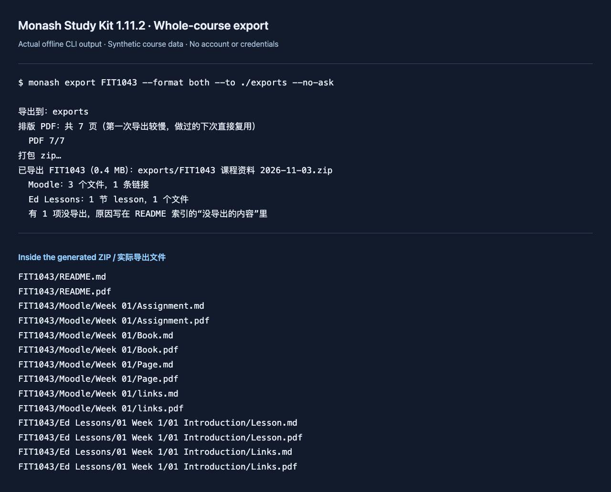

`monash export` 会把一门课在 Moodle 和 Ed Lessons 上的东西打成一个包，存到你电脑上，不需要 AI 软件也能用。作业说明会带上，你自己交的作业、成绩、反馈、Ed 讨论区、邮件、私信和考勤都不会放进去

最省事的是直接跟 AI 说：“把 FIT2109 的资料全部打包给我”，它会帮你跑同一条命令



上面的示例故意留了一个缺失的附件和一个账号打不开的 Google 链接。真实的课也常有几个这样的，所以导出后看一眼包里的索引

## 第一次导出

[装好](/zh-cn/study-kit/install/)并[设置完](/zh-cn/study-kit/setup/)以后：

```bash
monash courses
monash export FIT2109 --sync --format both --to "./exports"
```

先确认这门课在 `monash courses` 里勾上了，FIT2109 换成你自己的课号

- `--sync` 会先拉一遍这门课最新的 Moodle 内容和 Ed Lessons，不拉 Ed 论坛帖子。不加的话就用电脑上已经有的
- `--to` 是保存到哪个文件夹，不是压缩包的名字。不写的话会弹出选文件夹的窗口，默认是你上次选的位置或者“下载”文件夹（Windows 上挪过位置的下载文件夹也认得）
- `--no-ask` 不弹窗口，`monash config export_dir "./exports"` 可以记住保存位置
- `--dir` 存成文件夹而不是压缩包，`--open` 导出完在访达或资源管理器里打开
- 路径里有空格的话，macOS 和 Windows 上都要加引号

## 包里有什么

| 来源 | 导出的内容 |
| --- | --- |
| Moodle 文件和文件夹 | 原文件和子文件夹 |
| Moodle 的 Page、Book 和作业 | 正文、你能看到的评分标准，还有附件 |
| Ed Lessons | 按 Ed 里的顺序排好的模块和 lesson、幻灯片、阅读页、Ed 里附的文件，以及测验题（没有答案） |
| 图片 | Moodle 和 Ed 的图片存在 `assets/` 里，在本地就能显示 |
| 课程里链接的 Google 文件 | Docs 和 Slides 存成 PDF（Docs 也可以选 DOCX），Sheets 存成 XLSX，其他 Drive 文件保持原样 |
| 索引 | 包里有什么、什么时候同步的、哪些没下载到以及原因 |

课号文件夹里有 `Moodle/`、`Ed Lessons/` 和索引。PDF、notebook、压缩包这些原本的课件保持原格式。下载不了的外部链接就留成链接，它不会把整个网站扒下来。链接里的会议密码会被去掉

## Google 文件

Google 文件要多装一个组件，再单独登录一次 Google：

```bash
uv tool install --reinstall --refresh "monash-study-kit[gmail]"
monash google login
monash google status
monash export FIT2109 --refresh-google --format both --to "./exports"
```

这个组件名字叫 `gmail`，但 Drive 是单独登录的，不会碰你的邮件。之前装过别的组件的话，在这条安装命令里一起写上

- `--refresh-google` 会重新导出 Google 文件，同时也会同步。只想同步不打包，用 `monash sync --refresh-google`
- `monash config google_docs_format docx` 让 Google Docs 存成 DOCX，Slides 还是 PDF
- 它向 Google 要的是 **`drive.readonly`**。这个权限能读你账号能打开的所有文件，但 Study Kit 只拿课程里链接到的那些，也改不了 Drive 里的任何东西。邮箱是另一次登录（`monash gmail login`），见[隐私和安全](/zh-cn/study-kit/privacy/)

Google 文件太大、Drive API 没开、被管理员限制、或者没共享给你，都可能导出失败。这时 Study Kit 会试一下它自己登录浏览器里的 Google 登录状态，但绕不过文件权限。Google Forms 不导出。`monash google logout` 会先撤销授权，撤销失败就保留本地令牌，方便你再试

## PDF 还是 Markdown

```bash
monash export FIT2109 --format pdf --to "./exports"
monash export FIT2109 --format md --to "./exports"
monash export FIT2109 --format both --to "./exports"
monash config export_format both
```

默认是 PDF。`both` 会同时给你能编辑的 Markdown 和 PDF。PDF 是用 Chrome、Edge 或 Brave 开一个临时窗口生成的，这个窗口不会联网加载任何东西。三个浏览器都没有的话就退回 Markdown，索引里会写原因。加 `--json` 可以输出给程序读的结果

生成过的 PDF 存在 `data/pdf-cache/`，下次导出更快，超过 500 MB 会删掉最旧的。Moodle 文件夹一般最多一周检查一次

## 另开一个只导资料的账号

比如交换期间想导另一个 Monash 账号的课件，可以这样：

```bash
monash --profile exchange setup
monash --profile exchange google login
monash --profile exchange export FIT2109 --sync --format both --to "./exports"
monash profile list
monash profile remove exchange
```

每个 profile 有自己的登录、文件和数据库，只管课程资料：Moodle、链接的 Google 文件和 Ed Lessons。邮箱、考勤、Ed 讨论区、日历、远程模式、`monash connect` 和 `monash move` 都不能用，setup 也不会把它接进 AI 软件。你原来的账号不受影响

`monash profile remove NAME`（在原来的账号下运行）会先退出 Google，退出失败就什么都不删；成功的话清掉登录信息，下载好的文件留着，加 `--all` 才会一起删掉。Ed 令牌要你自己去 Ed 的令牌页面删除。把导出的资料发给别人之前，先看看[隐私和安全](/zh-cn/study-kit/privacy/)

## 缺东西怎么办

- 看看这门课在 `monash courses` 里有没有勾上、有没有同步过，对应的 Ed 课会自己跟上
- Moodle 登录窗口还没登完就被关了的话，运行 `monash login` 再试一次。macOS 上 Chrome 关掉窗口后可能还在后台跑
- Google 出问题就运行 `monash google status`，用对的账号重新登录，再加 `--refresh-google` 导出。没共享给你的文件还是拿不到
- 缺了哪些文件、哪些图片没存下来、Google 文件为什么失败，索引里都有
- 超过大小上限或者属于排除类型的文件不会在包里，`monash skipped` 能列出来，`monash skipped --get` 补下想要的（[说明](/zh-cn/study-kit/cli/#看看跳过了哪些想要的再补下)）
- 没有 PDF？装一个 Chrome、Edge 或 Brave，或者用 `--format md`
- 只有 AI 软件开着的时候才会自动同步。只用终端的话，导出时加上 `--sync`
